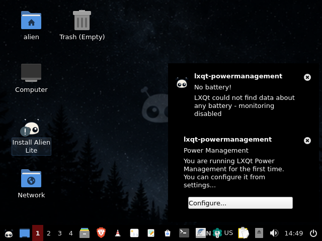
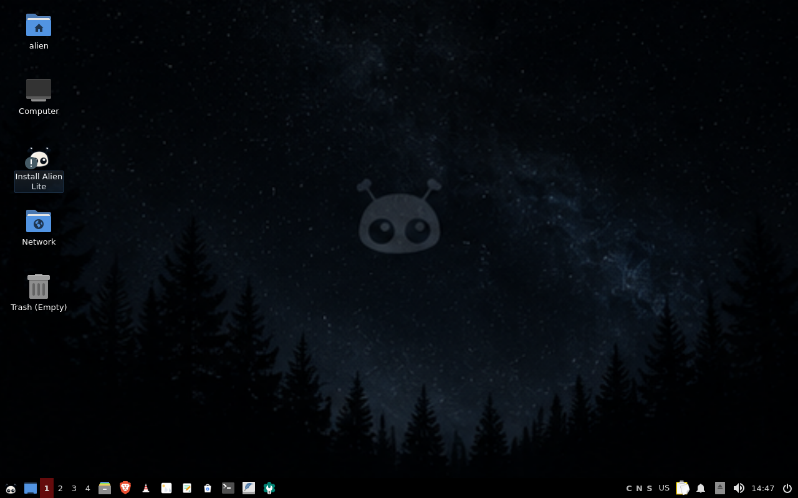

# Alien OS (Lite Edition)

[](https://github.com/10974-Spec/alien-linux-os/releases)
[](LICENSE)
[](https://www.debian.org)

**Alien OS** is a lightweight, modern, production-grade Linux operating system designed for speed, visual elegance, and everyday productivity. Built on the rock-solid foundation of Debian 13 (Trixie) with the lightweight LXQt desktop environment, Alien OS combines high performance, low memory usage, and curated everyday applications.

---

## Visual Showcase

### Default Desktop Experience


### Curated Wallpaper Collection (11 Wallpapers)


---

## Key Features

- **Blazing Fast & Lightweight**: Boots into under 500 MB idle RAM with sub-second application launch times.
- **Modern LXQt Desktop**: Powered by Openbox window manager and Picom compositor for tear-free, fluid visuals.
- **Instant Productivity**:
  - **Web**: Brave Browser (secure, privacy-focused, pre-configured).
  - **Video & Media**: VLC Media Player (universal codec support).
  - **Images**: LXImage-Qt (fast, lightweight image viewer).
  - **Notes & Writing**: Ghostwriter (distraction-free Markdown editor) and FeatherPad.
  - **Software Center**: Synaptic Package Manager & AppStream integration.
  - **Terminal**: QTerminal with customized prompt and color scheme.
- **Custom Alien Artwork & Wallpapers**: 11 custom wallpapers in resolutions up to 4K, featuring the default `panel_3_1` background.
- **Silent Boot Experience**: Custom Plymouth graphical boot splash and clean, hidden bootloader handoff.
- **Robust Filesystem**: Optional Btrfs subvolume layout with automated snapshot support.

---

## Download & Verification

Official pre-built ISO images are available on the [GitHub Releases page](https://github.com/10974-Spec/alien-linux-os/releases).

### Current Release: `v0.1.0`
- **Build ID:** `20261014-1409-5cadbfc`
- **Architecture:** `amd64` (x86_64)
- **Target ISO:** `alien-lite-v0.1.0-20261014-1409-5cadbfc-amd64.iso`

### Integrity Verification
Always verify the cryptographic integrity of downloaded ISO files:
```bash
sha256sum -c SHA256SUMS
```
Expected SHA-256 Checksum:
```text
f0d51e03ebcaa7dc264dc68913f51a3f7e40351dbe99d00e42d8c3374b1fda47  alien-lite-20261014-1409-5cadbfc.iso
```

---

## Testing in Virtual Machines

### QEMU / KVM (Recommended)
Alien OS boots in both UEFI (OVMF) and legacy BIOS mode. Run directly using QEMU:
```bash
# Live UEFI testing:
qemu-system-x86_64 -enable-kvm -machine q35 -cpu host -smp 2 -m 4096 \
  -vga virtio -display gtk,zoom-to-fit=on \
  -drive if=pflash,format=raw,readonly=on,file=/usr/share/OVMF/OVMF_CODE_4M.fd \
  -cdrom alien-lite-*.iso -boot d
```
Or use the repository helper:
```bash
./tests/test-in-qemu.sh out/alien-lite-20261014-1409-5cadbfc.iso
```

### VirtualBox
1. Create a new 64-bit Linux virtual machine (Debian 64-bit).
2. Allocate at least 2 vCPUs and 2048 MB (2 GB) RAM (4 GB recommended).
3. Under **Settings → System → Motherboard**, check **Enable EFI (special OSes only)**.
4. Under **Settings → Display**, allocate 64 MB video memory and enable VMSVGA.
5. Attach the downloaded ISO to the virtual optical drive and boot.

---

## Writing to a USB Drive

### Option 1: Balena Etcher (GUI, Recommended for beginners)
Download [Balena Etcher](https://etcher.balena.io/), select the Alien OS ISO file, select your target USB drive, and click **Flash!**.

### Option 2: `dd` (Command Line, Advanced)
> [!CAUTION]
> The `dd` command will completely overwrite the target device without confirmation. Double-check your drive path (`lsblk`) before executing.

```bash
sudo dd if=alien-lite-20261014-1409-5cadbfc.iso of=/dev/sdX bs=4M status=progress conv=fdatasync
```
*(Replace `/dev/sdX` with the identifier of your target USB flash drive, NOT a partition like `/dev/sdX1`)*.

---

## Building from Source

Alien OS builds reproducibly in a containerized rootless live-build pipeline.

### Prerequisites
- Docker or Podman
- Python 3.10+
- GNU Make

### Build Steps
```bash
# Clone the repository:
git clone https://github.com/10974-Spec/alien-linux-os.git
cd alien-linux-os

# Render wallpapers pipeline:
make wallpapers

# Run quality gate checks:
make check

# Build the Lite ISO image:
./build/build.sh lite
```
The resulting ISO and sha256 checksum will be located in the `out/` directory.

---

## Known Limitations

- **Touchpad Gestures**: Multi-touch gestures under Openbox/X11 require manual `libinput-gestures` configuration.
- **Secure Boot**: Requires enrolling the machine owner key (MOK) on systems with strict third-party UEFI Secure Boot enforcement enabled.
- **High-DPI Scaling**: Fractional scaling under X11 is limited; integer 2x scaling is supported via LXQt Session Settings.

---

## Credits & Attributions

- **Icons & Artwork**: Application iconography based on Icons8 Color style. Courtesy of [Icons8](https://icons8.com).
- **Icon Theme**: Papirus Icon Theme (GPL-3.0) by the Papirus Development Team.
- **Upstream Distribution**: Powered by [Debian GNU/Linux](https://www.debian.org).
- **Core Software**: VLC Media Player, LXQt, Brave Software, FeatherPad, and Ghostwriter.

## License

Alien OS scripts, configuration tools, and original system utilities are licensed under the [GNU General Public License v3.0](LICENSE). Third-party components, upstream Debian packages, and art assets retain their respective licenses as detailed in [THIRD-PARTY.md](THIRD-PARTY.md) and [`docs/LICENSES.md`](docs/LICENSES.md).
